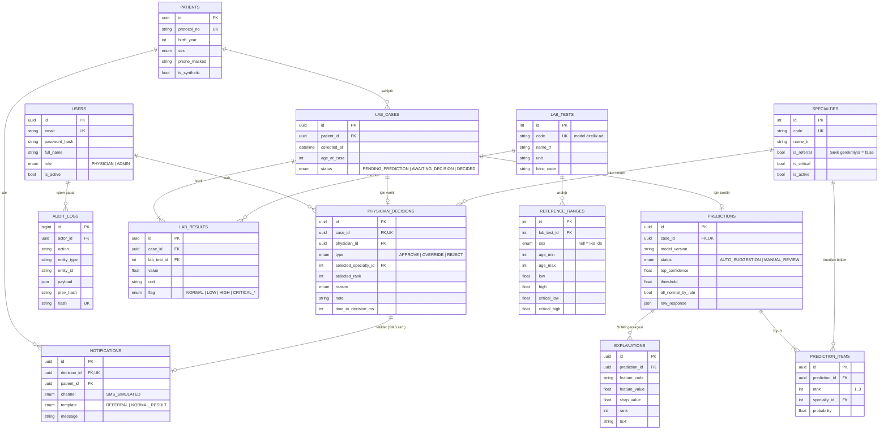

# ER Diyagramı ve Veritabanı Şeması (Taslak v1)

> Aşama 1 / Hafta 5 teslimi. Kaynak şema: [`backend/prisma/schema.prisma`](../backend/prisma/schema.prisma)

Veritabanı yalnızca **klinik akışı** (hekim paneli) saklar. Tahlil yükleme (bilgilendirme) modülü bu veritabanına **yazmaz**; yüklenen veri varsayılan olarak saklanmaz (Rapor §3.1, §4).

## Diyagram

## Tablolar ve Rapordaki Karşılıkları

| Tablo | Görev | Rapordaki karşılığı |
| --- | --- | --- |
| `users` | Hekim ve yönetici hesapları, rol | §4 Güvenlik — JWT, rol bazlı yetki |
| `patients` | Sentetik hasta; ad/TC tutulmaz | §5.4 Sentetik veri, §9 KVKK veri minimizasyonu |
| `lab_cases` | Bir hastanın tek seferlik tahlil seti (vaka) | §3 adım 1; §6.1 başvuru anı / ilk 24 saat |
| `lab_tests`, `reference_ranges` | Tahlil kataloğu, cinsiyet/yaşa göre referans ve kritik aralık | §3 anomali vurgusu, §3.1 kritik değer uyarısı, LOINC notu |
| `lab_results` | Tahlil değerleri ve `flag` (kural tabanlı kontrol) | §8 Objektif Veri Paneli |
| `specialties` | Uzmanlık sınıfları (eşleme tablosuyla aynı kodlar) | §5.2, [etiket-esleme.md](etiket-esleme.md) |
| `predictions` | Model sürümü, kalibre güven, eşik, MANUAL_REVIEW durumu | §6.5 Güven skoru ve eşik |
| `prediction_items` | Top-3 öneri | §3 adım 3 |
| `explanations` | SHAP + referans aralığı şablon metni | §7 XAI |
| `physician_decisions` | Onay / override / red, gerekçe kodu, karar süresi | §8 Onay paneli, otomasyon yanılgısı önlemleri, §10 |
| `notifications` | SMS simülasyonu (tanı/tahlil bilgisi içermez) | §3 SMS içeriği, normal sonuç akışı |
| `audit_logs` | Değiştirilemez denetim kaydı (hash zinciri) | §4 Güvenlik, §1 Hedefler |

## Tasarım Kararları

1. **"Sevk gerekmiyor" ayrı bir karar türü değil, bir uzmanlık sınıfıdır** (`specialties.is_referral = false`). Böylece model çıktısı ve hekim kararı tek yapıda tutulur; bildirim şablonu (`REFERRAL` / `NORMAL_RESULT`) seçilen sınıftan belirlenir.
2. **Normal sonuç iki koşula bağlıdır** (Rapor §3): `predictions.all_normal_by_rule = true` **ve** Top-1 = `NO_REFERRAL` ile güven ≥ eşik. Biri sağlanmazsa `status = MANUAL_REVIEW`.
3. **Gerekçe kodu (`reason`)**: OVERRIDE ve REJECT'te, ayrıca `MANUAL_REVIEW` vakada onayda zorunludur. Bu kontrol NestJS servis katmanında yapılır. Hekim reddi model hatası anlamına gelmeyebileceği için (Rapor §10) `SUSPECTED_MODEL_ERROR` ayrı bir koddur; yeniden eğitime yalnızca incelenmiş kayıtlar alınır.
4. **Otomasyon yanılgısı izleme**: `time_to_decision_ms` ve karar türleri üzerinden hekim bazında onay/override oranı raporlanır (yönetici rolü).
5. **`raw_response` (JSON)** model servisinin tüm yanıtını saklar; model sürümü değişse bile geçmiş öneriler yeniden üretilebilir/izlenebilir.
6. **Denetim kaydı değiştirilemezliği**: uygulama yalnızca `INSERT` yapar, her satır önceki satırın hash'ini içerir. Aşama 4'te `UPDATE/DELETE`'i engelleyen PostgreSQL trigger'ı migration olarak eklenecek.
7. **Veri minimizasyonu**: hasta adı, TC kimlik no tutulmaz; telefon maskeli tutulur ve yalnızca SMS simülasyonu içindir.

## Açık Sorular (Aşama 2–4'te netleşecek)

- Nihai tahlil listesi (40–100 tahlil) Aşama 2'de NHANES dosyalarından çıkarılınca `lab_tests` seed verisi hazırlanacak.
- Tiroid ve Göğüs Hastalıkları sınıflarının v1'de kalıp kalmayacağı (`specialties.is_active`) veri sayısına göre belirlenecek.
- Bir vaka için birden fazla tahmin (ör. model sürümü değişince yeniden tahmin) gerekirse `predictions.case_id` üzerindeki tekillik kaldırılacak.
