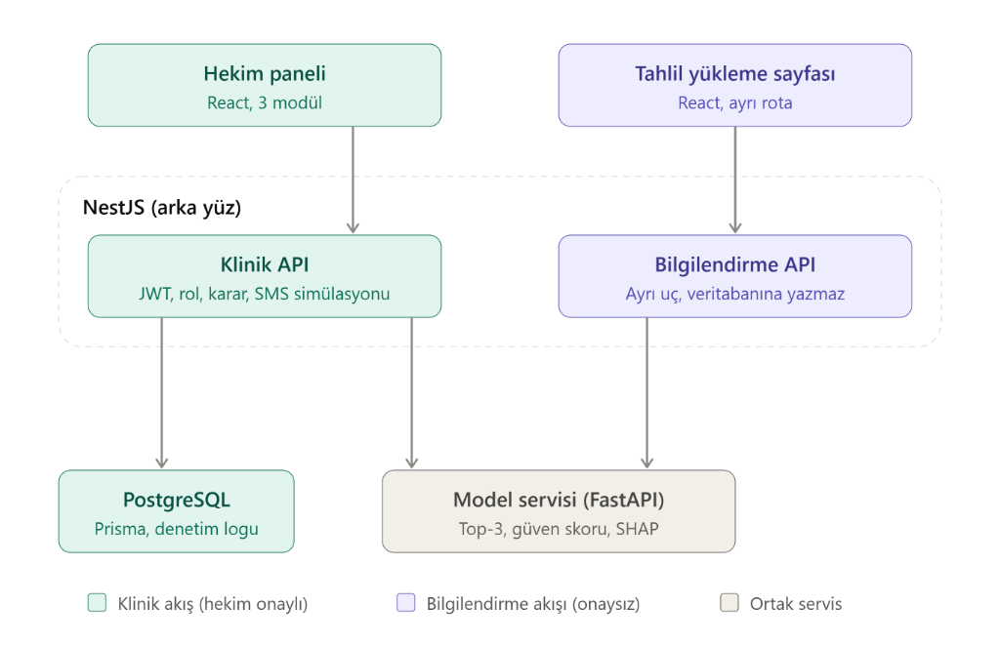
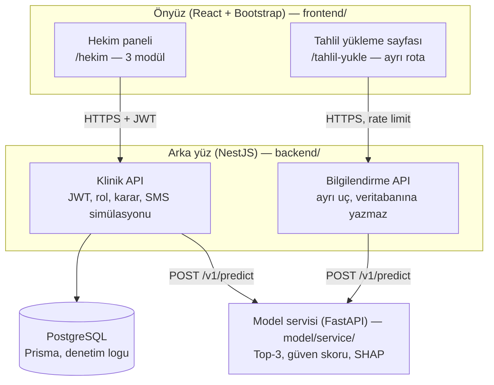
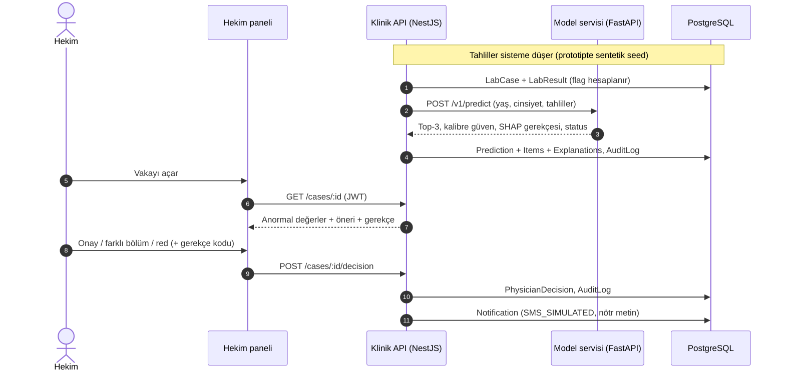
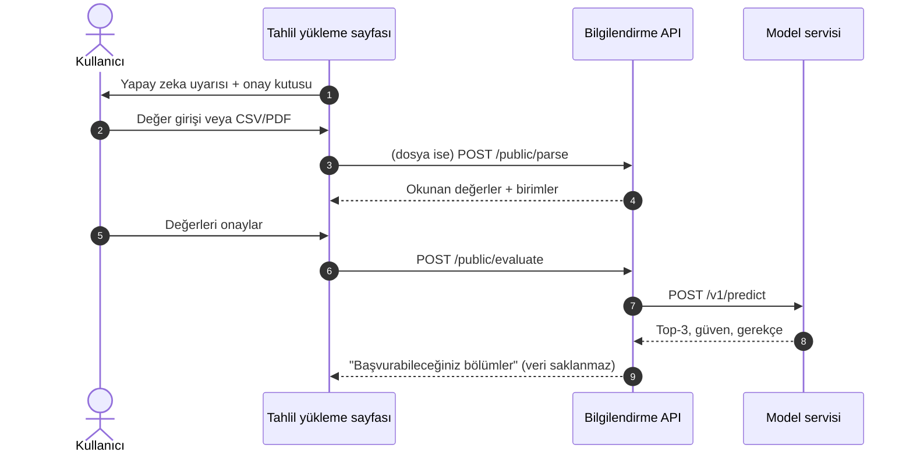

# Sistem Mimarisi (Taslak v1)

> Aşama 1 / Hafta 5 teslimi. Rapor §4 ile uyumludur.

## Bileşenler

| Bileşen | Klasör | Teknoloji | Sorumluluk |
| --- | --- | --- | --- |
| Hekim paneli | `frontend/` | React, Bootstrap | Objektif veri paneli, yapay zeka karar ve gerekçe paneli, onay ve aksiyon paneli |
| Tahlil yükleme sayfası | `frontend/` | React | Uyarı + onay kutusu, form / CSV-PDF yükleme, değerlerin kullanıcıya onaylatılması |
| Klinik API | `backend/` | NestJS, TypeScript, Prisma | Kimlik doğrulama, rol, vaka/tahlil, model çağrısı, karar kaydı, SMS simülasyonu, denetim logu |
| Bilgilendirme API | `backend/` | NestJS (ayrı modül) | Girdi doğrulama, dosya tür/boyut kontrolü, istek sınırlama; **veritabanına yazmaz** |
| Veritabanı | `backend/prisma/` | PostgreSQL | Bkz. [er-diyagrami.md](er-diyagrami.md) |
| Model servisi | `model/service/` | Python, FastAPI, XGBoost, SHAP | Tahmin, kalibrasyon, SHAP gerekçesi. Sözleşme: [model-servisi-sozlesmesi.md](model-servisi-sozlesmesi.md) |

## Akışlar

### Klinik akış (hekim onaylı)

### Bilgilendirme akışı (onaysız)

## Temel İlkeler

- **ML kodu NestJS içinde çalışmaz.** Model ayrı FastAPI servisidir; NestJS HTTP ile çağırır. Giriş-çıkış sözleşmesi sabittir, veri seti/model değişse de diğer katmanlar etkilenmez.
- **Hekim onayı olmadan hiçbir işlem yapılmaz**; SMS yalnızca karar sonrası ve yalnızca simüle edilir, tanı/tahlil bilgisi içermez.
- **Bilgilendirme modülü klinik akıştan ayrıdır**: ayrı rota, ayrı API ucu, denetim loguna ve hasta kayıtlarına yazmaz, veriyi varsayılan olarak saklamaz.
- **Güvenlik**: JWT + rol (PHYSICIAN, ADMIN), TLS, append-only denetim kaydı, istek sınırlama, dosya tür/boyut kontrolü.

## Geliştirme Ortamı Portları (öneri)

| Servis | Port |
| --- | --- |
| React (Vite) | 5173 |
| NestJS | 3000 |
| FastAPI | 8000 |
| PostgreSQL (docker compose) | 5432 |
